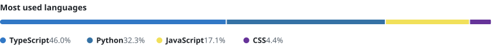

<h1 align="center">Hey, I'm Sankalp 👋</h1>

AI engineer from New Delhi · the frontend is where I have the most fun

  

  
  

---

### 🙋 About me

- 🔭 Currently building at **IntelGrader**, an app that grades handwritten answer sheets
- 🧠 Into on-device ML, LLM tooling, and fast, clean interfaces
- ⚡ Shipped six production platforms during my internship at RoadVision AI
- 🎓 B.Tech in AI & ML (2026), with four published papers

### 🛠️ Tech stack

| Area | Stack |
|:--|:--|
| **Languages** |  |
| **Frontend & mobile** |  |
| **Backend & data** |  |
| **AI / ML** |  |
| **Cloud & tools** |  |

### 🚀 Things I've built

| Project | What it does | Built with |
|:--|:--|:--|
| **[Sentiment Pulse](https://github.com/SankalpMathur05/sentiment-pulse)** [live demo](https://sentiment-pulse-tawny.vercel.app) | A sentiment model I trained from scratch, served behind a live analytics dashboard |  |
| **[MedLens AI](https://github.com/SankalpMathur05/Medical-Prescription-OCR)** [live demo](https://medical-ocr-kappa.vercel.app) | Turns photos of handwritten prescriptions into structured data and a PDF report |  |
| **[PrepWise AI](https://project-7ppyq.vercel.app)** live beta | AI mock interviews and coding practice across 12 career tracks |  |
| **AutoMailer** private | Paced job-outreach emails with AI-written openers and follow-ups |  |
| **[Universal Web Scraper](https://github.com/SankalpMathur05/Universal-Web-Scraper)** | Scrapes any site into tidy, section-by-section JSON |  |
| **[SkillNest](https://github.com/SankalpMathur05/Smarrtif-Assignment-SkillNest)** [live demo](https://smarrtif-assignment-skill-nest.vercel.app) | A course platform with student and admin roles |  |

### 💼 Experience

**IntelGrader** · AI & Backend Engineer Intern · *Oct 2026 – now*
- On-device page detection and orientation models (PyTorch → ONNX, running in Kotlin) for the answer-sheet camera
- An in-app AI assistant with tool calling, and bug-report triage with Qwen3-VL

**RoadVision AI** · Software Development Intern · *Mar – Sep 2026*
- An annotation platform holding 10M+ frames and 2.6M+ labels
- A hiring platform, GIS survey apps, and a zero-downtime MongoDB → PostgreSQL migration

**Quadrafort Technologies** · Full-Stack Developer Intern · *Jul – Aug 2025*
- A MERN task manager with role-based access

### 📊 GitHub activity

<picture>
  <source media="(prefers-color-scheme: dark)" srcset="https://raw.githubusercontent.com/SankalpMathur05/SankalpMathur05/main/assets/languages-dark.svg">
  
</picture>

<picture>
  <source media="(prefers-color-scheme: dark)" srcset="https://raw.githubusercontent.com/SankalpMathur05/SankalpMathur05/output/snake-dark.svg">
  
</picture>

